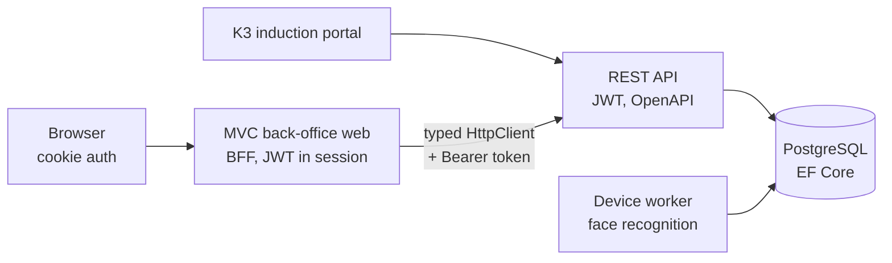

## Background / Problem

The gate security system covers visitor and contractor registration, work permits, occupational safety (K3) induction, receptionists, permanent contacts, violations, and face recognition devices. It ran on a legacy web app (old ASP.NET MVC). The app needed to move to a modern stack (.NET 10, PostgreSQL), with a separate data layer, a JWT-secured API, and a consistent UI.

## Solution & Architecture

- **Multi-project solution:** a data library (EF Core + Npgsql), a REST API (JWT, OpenAPI), the MVC back-office web app, the K3 induction portal, a device worker service, and a device SDK wrapper.
- **Back-office web app as a BFF:** the browser uses cookie auth, while the JWT from the API is kept in the server session and attached by a Bearer token handler. A cookie without a valid token is treated as logged out.
- **API access layer:** a typed HttpClient plus one service per resource as the only place that knows endpoint paths. Controllers are thin and async.
- **Page conventions:** Areas per module, nested view models (Index/Add/Edit), grid partials reloaded via AJAX, shared modals, shared JS helpers, and DevExtreme for forms and tables.
- **Security:** records are accessed through encrypted keys valid for one day, anti-forgery tokens on every AJAX POST, a single-use HMAC captcha, and secrets configured via user-secrets/env.
- **Tooling:** an enum generator from the API, a report page generator from a single spec, a controller generator, and a theme recolor script.

<!-- Diagram disederhanakan dari rekap analisis kode, bukan dari dokumen arsitektur resmi -->

### Modules

- **Master data:** customers, meeting types, facilities, machines, locations, meeting rooms, departments, documents, safety tools, damage types, positions, entry locations, and more.
- **Working permits, registration, induction, meeting rooms:** visitor/contractor registration with approval, work permits, K3 induction schedules, and meeting room booking.
- **Receptionist & capture:** visitor check-in/out, identity capture through the browser camera, and ID card printing.
- **User & API management:** menus, roles with an access rights tree, approval workflows, user logins, and API accounts per web service.
- **Violation, Induction Online, PAN, cards:** violations with multi-level approval, induction quizzes and materials, ship crew monitoring, and an ID card layout editor.
- **Reports:** 11 reports with filters, grids, and Excel export, generated from a single spec.

## Technical Challenges

- **Token and session expiry out of sync:** the cookie has a 3-hour sliding window, the session a 3-hour idle timeout, the JWT is valid until midnight, and the in-memory session disappears on restart. The fix: token validity is checked on every request, and a 401 from the API clears the token so the next request logs out cleanly.
- **API errors that are all HTTP 200:** the API always responds 200 with the status inside the envelope. The client maps that status to specific exceptions: business messages to the user, 401 logs out, 403 access denied, 429 rate limited, and other errors logged with a TraceId.
- **DevExtreme theme and the admin template's dark mode:** the template stores settings only in `sessionStorage` and reloads when the `<html>` attribute changes. The fix: the mode is saved to `localStorage`, `sessionStorage` is filled before the layout script runs, and the DevExtreme theme switches when the mode changes.
- **Gradual migration:** many legacy pages first had their UI cloned with dummy data, then were connected to the API module by module without changing the page conventions.

## Results / Impact

<!-- TODO: verifikasi — isi dengan dampak nyata (jumlah halaman yang dimigrasi, pengguna, atau waktu proses) -->

## What I Learned

<!-- TODO: verifikasi -->
