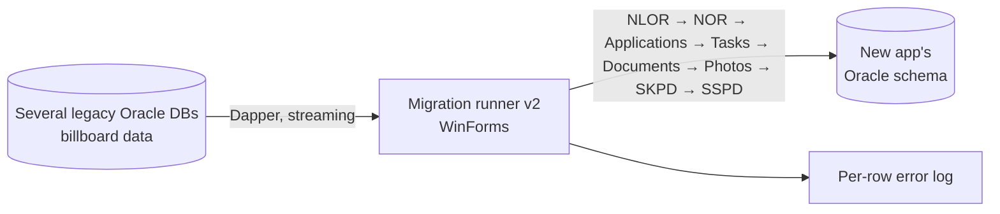

## Background / Problem

Billboard tax data was spread across several legacy Oracle databases: taxpayers, billboard objects and locations, permit applications (temporary, permanent, limited), field survey results and their photos, assessments (SKPD), and payments (SSPD). This data had to move into the new application's schema, which is structured differently (composite keys, per-side details, workflows).

The legacy data quality was also inconsistent: duplicate form numbers, empty required columns, and differing type codes.

## Solution & Architecture

- **Shared data layer:** EF Core models scaffolded from the target schema and a connection factory.
- **Migration service pattern:** each data type has one service with a source DTO. The flow: query the source with SQL via Dapper, map to the target entity (including mapping old billboard type codes to the new master data), save via EF Core, then report progress to the UI.
- **Error tolerance:** failed rows are detached from the change tracker and logged through a separate context. A logging failure doesn't stop the migration.
- **Operator UI:** WinForms with a progress bar per stage or per year. The work runs in a background task so the UI doesn't freeze.
- **Three generations of tooling:** v1 (one button per data type), FotoSurvey (photos only, per year), and the v2 runner (a sequential, idempotent pipeline with connection retries).

<!-- Diagram disederhanakan dari rekap analisis kode, bukan dari dokumen arsitektur resmi -->

## Technical Challenges

- **Data volume and photo BLOBs:** reading photos is split into two stages (a list without BLOBs, then filling content per chunk), and existing photos are checked before their content is pulled. Other source data is streamed through a data reader.
- **One bad row failing a whole batch:** batches are saved with a single `SaveChanges`. If it fails, the change tracker is cleared and the data is retried one row at a time, so only the problem rows end up in the log.
- **Application-generated composite keys:** service sequence numbers are calculated per year and month, continue from the maximum value in the destination, and are rolled back when a batch fails so there are no gaps.
- **Database connections dropping mid-migration:** Oracle session and network error codes are detected, the connection pool is cleared, and the stage is retried (up to 5 attempts, 30 seconds apart). Because stages are idempotent, a retry effectively resumes the process.
- **Inconsistent legacy data:** required columns are validated and logged, duplicate forms are forced into a single row, and old type codes are mapped to the new master data.

## Results / Impact

<!-- TODO: verifikasi — isi dengan dampak nyata (mis. jumlah data termigrasi) -->

## What I Learned

- Oracle resource limits (cursors, connections) become very real once you raise parallelism.
- Progress monitoring and logging are a requirement for a trustworthy migration, not an extra feature.

<!-- TODO: verifikasi — pelajaran lain dari project ini -->
