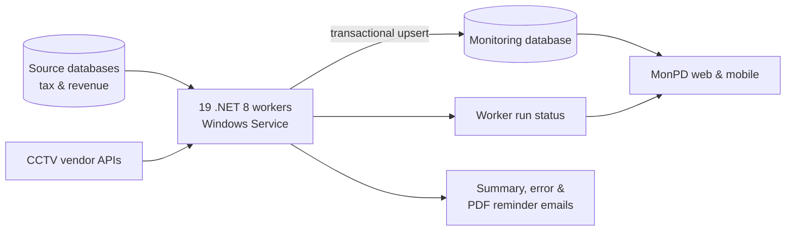

## Background / Problem

The [MonPD](/en/projects/monpd) dashboards need realization and assessment data for every tax type, revenue data, and parking CCTV data. That data is spread across many different databases and vendor APIs. If the web app fetched and processed all of it when a page opened, pages would be slow and the source databases would be overloaded. So a background process was needed to copy and prepare the data on a schedule.

## Solution & Architecture

- **One worker per data domain:** each tax type or data source has its own .NET 8 worker running as a Windows Service. A failure in one source doesn't stop the others, and each worker can be deployed and restarted on its own.
- **Shared library:** the workers use the same domain class library and EF Core as the web app, so data models and business rules stay consistent.
- **Sync pattern:** fetch data from the source per fiscal year, compare it with the destination, then insert/update/delete inside a single transaction. Cancelled data is cleaned up, and progress and change counts are logged.
- **Operational monitoring:** every worker writes its run status (start, finish, next schedule, errors), which the web and mobile apps read. Daily summary emails and error emails are sent automatically.
- **CCTV:** the real-time worker processes all parking objects in parallel, refreshes vendor API tokens, retries failed requests with incremental delays, then stores recap data and real-time events. A desktop tool (WinForms) is used for camera monitoring, vendor data sync, and manual history pulls.
- **Automated documents:** the Filing Reminder worker generates PDF letters and sends them by email.

<!-- Diagram disederhanakan dari rekap analisis kode, bukan dari dokumen arsitektur resmi -->

### Worker groups

- **PBJT & regional tax sync:** Hotel, Restaurant, Entertainment, Parking, PPJ, ABT, BPHTB, and the PKB & BBNKB Opsen.
- **Billboard sync:** billboard assessments and realization per fiscal year, cleanup of cancelled data, and a daily summary email.
- **Supporting data & targets:** recording devices, occupancy, persons in charge, revenue realization, and targets broken down from annual into monthly and daily.
- **Parking CCTV:** vehicle counts, events, and images from two vendors, plus a supporting desktop tool.
- **Reminder notifications:** PDF reminder letters for tax objects, sent by email.

## Technical Challenges

- **Data consistency during large syncs:** changes per fiscal year run inside a transaction with rollback, so dashboards never read half-finished data. Insert/update/delete counts are recorded on every run for auditing.
- **CCTV vendor APIs that aren't always stable:** requests get retries with backoff and a cancellation check on every attempt, tokens refresh automatically, and parking objects are processed in parallel so one slow object doesn't hold up the rest.
- **Knowing when a worker is in trouble:** run status is stored centrally and then classified (running, stuck, failed, late) in the web and mobile apps, plus error emails. Dashboards use the last run time to reload the cards whose data changed.

## Results / Impact

- It is the main data source for the MonPD dashboards, which are live for Bapenda, UPTB 1–5, and several Surabaya city departments.
- Payment data for every tax type is refreshed on a schedule, so users don't have to process data by hand.

## What I Learned

- **Designing worker services.** This was new to me. The workers sync payment data for every tax type on a schedule so the system's data is always current and close to real time. I learned to separate heavy processing from the web app and to monitor worker health (status, last/next run, errors).
