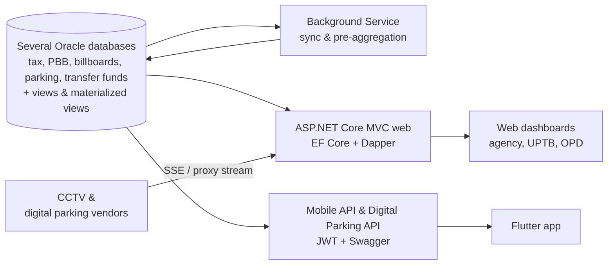

## Background / Problem

At the Regional Revenue Agency (Bapenda) of Surabaya City, revenue data is spread across several systems and databases: regional taxes, property tax (PBB), billboards, parking, transfer funds, and legacy systems. Leadership and UPTB officers needed one place to track realization against targets every day. They also needed to oversee tax object compliance (who hasn't paid for each tax period) and watch parking objects live through CCTV and digital transactions.

## Solution & Architecture

- **ASP.NET Core MVC web app (.NET 8)** with thin controllers. Query logic lives in ViewModels and domain classes in a shared class library, which the [MonPD Background Service](/en/projects/monpd-background-service) project also uses.
- **Multi-database data layer:** one database-first EF Core DbContext per Oracle data source, plus Dapper for aggregation queries. Heavy data is pre-aggregated by the Background Service and by Oracle views and materialized views I built, and the web reads the results. The web shows each worker's status on the Settings page and uses it to auto-refresh dashboards.
- **Authorization:** session-based login with a global filter and two login audiences (internal staff and non-Bapenda officers). Data is restricted per area based on role on the server side, and the navigation menu is built from per-role data.
- **Real time:** SSE endpoints for the digital parking and CCTV dashboards that only send data when there is a new transaction. CCTV vendor video streams pass through a reverse proxy (YARP).
- **Frontend:** Razor + jQuery AJAX, DevExtreme/DataTables for grids, ApexCharts/ECharts for charts, Leaflet/Mapbox for maps. Shared scripts handle lazy-loaded cards, skeletons, retries, and number animations.
- **Digital Parking API:** a separate Web API project serving accumulated and per-object digital parking data, with Swagger and Serilog logging.
- **Mobile API & mobile app:** separate REST endpoints with JWT (access + refresh tokens) and Swagger UI, used by the Flutter mobile app (covered in a separate card).
- **Development:** I built nearly every module myself; other contributors helped finish some of them.
- **Output:** DevExpress PDF reports, Excel export/import, and QR codes.
- **Hosting:** IIS on Windows Server.

<!-- Diagram disederhanakan dari rekap analisis kode, bukan dari dokumen arsitektur resmi -->

### Main modules

- **Regional Tax Dashboard & Monitoring:** realization vs target per tax type (daily, monthly, per UPTB) and multi-year series.
- **Regional Revenue Monitoring:** realization across all departments with drill-down into local revenue (PAD), levies, and transfer funds, plus target comparison and planning.
- **Transfer Funds:** transfer fund entry, account and affairs data, and opening the fiscal year.
- **Tax Object & Taxpayer Data:** tax object search and profiles, assessments, data cards (PDF), and a spatial map.
- **PBJT Oversight:** paid/unpaid status per tax period for restaurants, hotels, entertainment, and more.
- **Parking & CCTV Oversight:** vehicle counts and live CCTV streaming, a live digital parking dashboard, parking attendant oversight, SLAs, and TSPark for field officers.
- **Billboard Oversight:** registration, surveys, findings entry, permit and billing monitoring, and jambong printing.
- **PBB Oversight:** monitoring of SPPT bills, potential, profiles, and property tax categories.
- **Strategic Reports:** payments and receivables, online recording devices, audits, and a revenue forecast calculator.
- **Area & Permit Monitoring:** realization per area/UPTB and parking permit monitoring.
- **Data Upload:** uploading targets, budget revisions (PAK), receivables, and tax categories from Excel.
- **User Management & Settings:** employees, users, roles, per-role menus, and worker service status.
- **Mobile API:** JWT login with refresh tokens, profile, dashboards, worker status, and Swagger docs for the Flutter app.
- **Digital Parking API:** endpoints for accumulated digital parking data, the list of parking objects, and per-tax-object data.

## Technical Challenges

- **Heavy dashboards from many data sources:** each card loads separately via AJAX with a skeleton and a retry button. Independent queries run in parallel, read queries run without change tracking, and heavy aggregation is handed off to the Background Service and to Oracle views and materialized views. The dashboard detects when a worker last ran and reloads only the related cards.
- **Live parking/CCTV data:** SSE uses a *watermark* of the last transaction time, so the full payload is only sent when there is new data. Connections are stopped through a cancellation token, and proxy buffering is turned off. Vendor video is proxied so vendor credentials never reach the browser.
- **Session expiry in an AJAX-heavy app:** AJAX requests get a 401 JSON response instead of a redirect, so the login page never gets injected into a grid. A global client-side handler shows a toast, then sends the user to the login page.
- **PBJT compliance business rules:** payment status per tax period accounts for the object's active period (open/close dates), nil returns, and the difference between realization by payment date vs by tax period.

## Results / Impact

- The web version is live and used by the agency (Bapenda), UPTB 1 to 5, and several other Surabaya city departments.
- Tax realization, tax object compliance, and parking/billboard/PBB oversight are now monitored from one platform instead of many separate systems.
- Users can see realization and oversight reports right away without processing data by hand.
- The Mobile API is available as the backend for the Flutter mobile app.

## What I Learned

- **Combining many databases in one data flow.** This was my first time pulling data from several Oracle databases at once in a single method to complete what is shown. I learned to manage multiple DbContexts, match data across sources, and run queries in parallel so pages stay fast.
- **Oracle views and materialized views.** Most of what I learned was actually on the database side. I built Oracle views and materialized views to combine data from various sources and pre-aggregate what the dashboards read, so pages don't have to recompute large data sets every time they open.
- **Server-Sent Events for live data.** In the Digital Parking and CCTV menus I used SSE so transaction and vehicle data arrive in real time without reloading the page. I learned to keep stream connections stable, send data only when there is a new transaction, and close connections properly when the user leaves the page.
