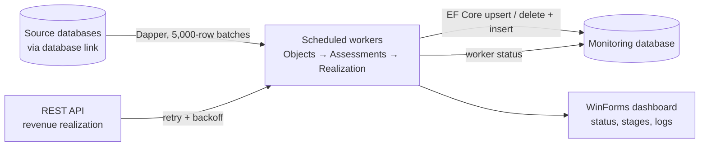

## Background / Problem

Regional tax data (tax objects, assessments, and payment realization per tax type, plus regional revenue realization) is spread across several source databases and API services. The monitoring system needs a consistent, regularly refreshed copy in one central database.

Previously this sync ran in several separate background services, which made the status and errors of each process hard to monitor. MonPDSync was built to gradually replace those services with a single app and a central status dashboard.

## Solution & Architecture

- **Two project layers:** a data class library (database-first scaffolded EF Core entities, connection helpers, status and tax type enums) and a WinForms app (UI + workers).
- **Abstract base worker:** each worker only defines its ordered stages. The base class handles the timer, an anti-overlap lock, cancellation, next-schedule calculation, and status, stage, and log events.
- **Service manager:** a registry of workers with Start/Stop all. Workers are enabled manually per tax type from the UI.
- **Read-write pattern:** sources are read with Dapper (raw SQL, `ROWNUM` paging, `ROW_NUMBER()` deduplication, cross-database-link queries). Targets are written with EF Core per batch using a fresh context and manual change tracking.
- **Year range loop:** assessments and realization are processed year by year from the configured start year to the current year. A failure in one year is logged and the next years still run.
- **Central status:** each worker's status (running, succeeded, failed, next schedule, error message) is written to the database so other systems can monitor it.

<!-- Diagram disederhanakan dari rekap analisis kode, bukan dari dokumen arsitektur resmi -->

## Technical Challenges

- **Large data volumes and Oracle limits:** data is read in steps of 5,000 rows, lookups of existing data are split into chunks of 900 keys, and inserts are saved every 1,000 rows. EF Core auto-detect-changes is turned off and the change tracker is cleared after each save to keep memory and time under control.
- **Replacing data without losing data:** realization is replaced per year with delete + insert in a single transaction. The delete only runs after the first source batch has been fetched successfully. If the source is empty or errors out, the transaction isn't committed and the old data stays intact.
- **Incomplete source data:** empty tax object numbers (NOP) get a unique substitute NOP, payments without a tax object are mapped to a placeholder object per area, missing assessments are created from realization data, and object close dates are derived from the latest assessment.
- **Scheduling and concurrency:** the one-shot timer is calculated from the previous scheduled time so a run never happens twice. A lock prevents overlapping runs, cancellation is always passed through so Stop takes effect immediately, and API calls get retries with backoff.

## Results / Impact

- **Service consolidation:** previously separate sync background services are being merged into a single app. The Revenue Realization (API) and Restaurant workers are live in production. The Hotel, Entertainment, and Parking workers are implemented but not live yet, and the other tax types are still scaffolds.
- **Easier monitoring:** each worker's status, active stage, logs, errors, and next schedule are visible on one dashboard and recorded to the database.

<!-- TODO: verifikasi — angka konkret (jumlah service yang digantikan, volume data, waktu proses) -->

## What I Learned

<!-- TODO: verifikasi -->
