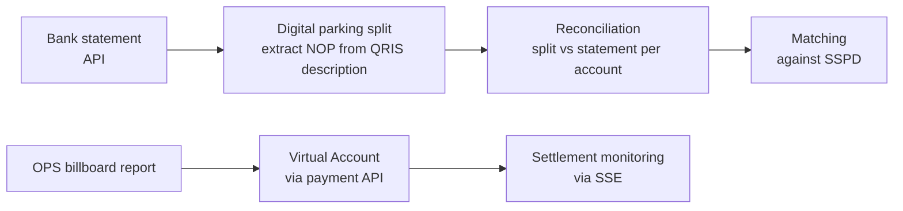

## Background / Problem

Regional revenue treasurers need to verify requests (for example, releasing billboard removal deposits), match money arriving in bank accounts against deposit records (SSPD), and process new revenue streams such as QRIS-based digital parking and on-site billboard enforcement. Manual processes are prone to discrepancies and slow to trace. <!-- TODO: verifikasi -->

## Solution & Architecture

- A three-layer .NET 8 solution: an MVC web app (UI + controllers), a shared domain and data class library, and a small Web API (JWT + Swagger) for e-payment integration.
- Hybrid data access: EF Core (Oracle) for CRUD and transactions, Dapper for heavy report and realization queries. Three DbContexts for three source databases.
- Authorization based on dynamic menus: each role maps to a list of controllers, and out-of-scope access is blocked in the base controller.
- A generic approval workflow (master workflow/activity + My Task) shared across request modules.
- DevExtreme UI (DataGrid/PivotGrid with Excel/PDF export) and DevExpress Reporting for printed documents.
- HTTP integration with the payment API (tokens, VA, VA/QRIS callbacks), the bank statement API, and the billboard assessment API.

<!-- Diagram disederhanakan dari rekap analisis kode, bukan dari dokumen arsitektur resmi -->

### Modules I worked on

- **Official Memo Requests & Treasurer Verification:** an SSPD-based request form with document upload, revenue treasurer verification, the My Task approval view, and official memo monitoring with SPP/SPTB/SPT printing.
- **Digital Parking (QRIS):** Digital Parking Split, Digital Parking Reconciliation, and Split Monitoring (master-detail). I also built the first version of Awaiting Transfer (debit statement split) before that module moved to another project.
- **Billboard Operations (OPS) & Stickers:** OPS Billboard Inspection Reports with Virtual Accounts (designed from scratch), Temporary and Finding Stickers, OPS Cancellation, and OPS Billboard Monitoring.

## Technical Challenges

- **Parsing and splitting QRIS statements:** the NOP is extracted from the transaction description text (strip the prefix, validate the length), then account data is resolved in a single batch query rather than row by row. Split results are reused when a statement entry has already been processed.
- **Split vs statement reconciliation:** matching per account with an in-memory full outer join pattern to show discrepancies on both sides.
- **Sticker and report data consistency:** issuing, using, and cancelling stickers and saving reports are wrapped in database transactions so header-detail data is never half-saved.
- **Real-time payment status:** an SSE stream checks each report's payment callback with a delay between checks. An error in one item doesn't break the stream, and the stream stops via a cancellation token when the client disconnects.

## Results / Impact

- Reconciling QRIS parking transactions with bank statements is no longer done by hand, so it's faster. <!-- TODO: verifikasi angka waktu sebelum/sesudah -->
- Processes transactions for more than 30 taxpayers per day.
- Billboard inspection reports from field operations can be paid straight away via Virtual Account, and their settlement status is tracked in monitoring.

## What I Learned

<!-- TODO: verifikasi -->
