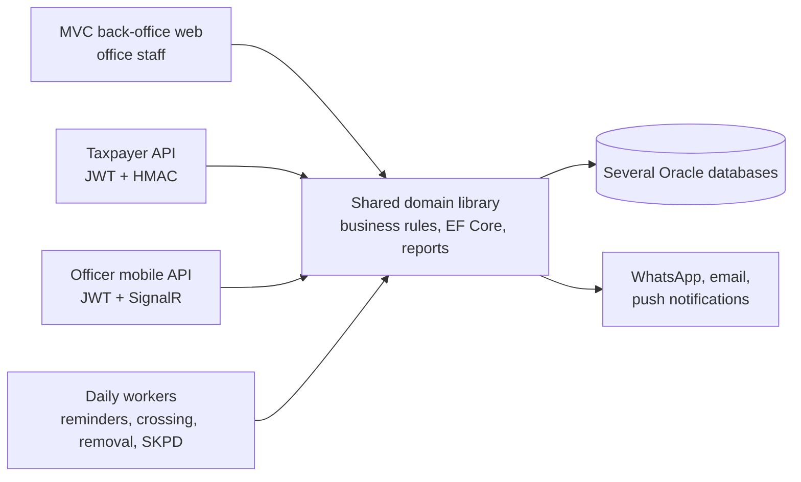

## Background / Problem

Regional tax administration at Bapenda Kota Surabaya (billboards, PBJT, taxpayer registration) involves many stages: submission, document review, field surveys, assessment, multi-level approval, issuing assessments, and overseeing billboards that have expired or are unpaid.

Field officers, office staff, and taxpayers each need a different channel. Many date-based steps also have to run automatically without manual intervention.

<!-- TODO: verifikasi — tambahkan konteks bisnis (sistem lama yang digantikan, skala pengguna) -->

## Solution & Architecture

- **A shared domain library** holds all business rules, queries, EF Core contexts, DevExpress reports, and email/WhatsApp templates. Every host calls this library, so business rules live in exactly one place.
- **Thin hosts:**
  - An MVC back-office web app (Razor + DevExtreme) for office staff, with session login and per-role menu access control.
  - A taxpayer API (JWT + HMAC app key) for public apps: billboards, groundwater tax, and QRIS/VA payments with real-time status via SignalR.
  - A mobile API for officers (JWT, rate limiting) for surveys, attendance, daily reports, and my tasks, plus a SignalR hub and a hosted service for real-time push.
  - A worker service per process stage (reminders, warnings, crossing out, un-crossing, removal, automatic SKPD, notifications, letter delivery). Every worker has a simulation (dry run) mode.
- **Data:** database-first EF Core against several Oracle databases. Business rules (day limits, survey radius, auto-decree mode) are read from settings in the database.
- **Cross-project conventions:** business time always comes from the database server clock (not the machine clock), IDs sent to clients are encrypted, and API responses use a standard envelope.
- **CI/CD:** GitLab CI builds every branch; the web app deploys to IIS and the APIs to Linux (systemd + nginx).

<!-- Diagram disederhanakan dari rekap analisis kode, bukan dari dokumen arsitektur resmi -->

### Modules I worked on

- **On my own:** the officer mobile API (API side; the mobile app was built by another team), auto-assignment and Assign Task Monitoring, the groundwater tax API, and master data and URM.
- **Major share:** the MyTask workflow (approvals and decrees) and automatic NPWPD issuance.
- **With the team:** billboard applications and assessment, findings oversight, and billboard master data.

## Technical Challenges

- **Fair distribution of field tasks:** survey, crossing, and removal tasks have to land automatically on the right officer. Candidates come from functional duty and area (urban village, then district, UPTB, and finally general officers), then are picked by monthly quota, total workload, workload in the area, and employee ID as a tie-breaker. Tasks assigned earlier in the same transaction are counted too, and every failure is logged with a readable reason in Assign Task Monitoring.
- **Reliable multi-channel NPWPD issuance:** one approval produces a decree, a QR-coded PDF confirmation letter, an activation code via WhatsApp and email, and an app notification. The decree is saved in a single transaction, while delivery never throws. Per-channel failures are recorded as delivery results, and the email still goes out even if the PDF fails to generate.
- **Real-time settings for the mobile app:** the survey check-in radius can be changed directly in the database. A hosted service re-reads the value periodically and broadcasts a SignalR event only when it changes. Newly connected clients receive the current value right away.
- **Mobile API security:** attendance endpoints are protected by a fixed-window rate limiter per user (falling back to IP), public routes are configured in middleware, and contact verification uses OTP.

## Results / Impact

<!-- TODO: verifikasi — belum ada angka; isi dampak nyata setelah ada data (jumlah petugas, permohonan/bulan, waktu proses) -->

## What I Learned

- **Multi-host architecture:** every business rule sits in one domain library shared by the back-office web app, two Web APIs, and over a dozen workers. Hosts stay thin, and a single rule change applies across all channels.
- **Real time and notifications:** SignalR + a hosted service to push settings changes to the mobile app, and multi-channel delivery (WhatsApp, email, app notifications) that doesn't fail the main process when one channel fails.
- **Assignment algorithms:** auto-assigning field tasks balanced by area, monthly quota, and workload, complete with failure reason logs so coordinators can follow up.

<!-- TODO: verifikasi — sesuaikan dengan pengalaman pribadi -->
