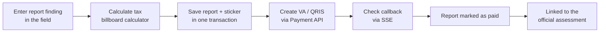

## Background / Problem

Enforcement of temporary billboards and entertainment in the field needs a bridge between officer findings, tax assessment, and payment. Officers need a tool to record findings, calculate tax, create bills, and confirm settlement without layers of manual work. On the taxpayer (WP) side, digital parking object owners need to monitor transactions and manage their attendants' devices. <!-- TODO: verifikasi konteks bisnis -->

## Solution & Architecture

- A single ASP.NET Core MVC app with two "shells": the taxpayer portal and the Supervisor portal for field operations (OPS) officers. Each has its own layout, navbar, and login (session-based staff login).
- Thin controllers, then view models, then domain classes in a shared library, then Oracle. EF Core is used for CRUD, Dapper for queries across data sources.
- DevExtreme grids with server-side paging and filtering, partial views for payment and print modals, and DevExpress reports for tax documents (SKPD, SSPD, SPTPD, stickers).
- A small contribution to the Payment service (ASP.NET Core Web API): endpoints to check active VA/QRIS per assessment and to check payment per VA/QRIS code.

<!-- Diagram disederhanakan dari rekap analisis kode, bukan dari dokumen arsitektur resmi -->

### Modules I worked on

- **Supervisor / OPS portal:** staff login, Temporary Billboard and Entertainment Inspection Reports, NIK verification and NPWPD creation, report payment and cancellation, billboard sticker printing.
- **Billing & arrears:** Tax Object Monitoring, Billboard Billing with combined VA/QRIS, multi-period Arrears (QRIS capped at a maximum amount). Part of this module was built together with a colleague.
- **OPS Billboard Monitoring:** lists of active and cancelled reports, document printing, and bulk settlement checks via SSE (my part: SSE, cancellation, payment).
- **Digital Parking (taxpayer side):** Parking Monitoring, User Device Management, Parking Gate Management, and a public Parking Data Check page from an encrypted QR code.
- **Groundwater Tax:** a yearly recap of groundwater (ABT) assessments with SKPD and SSPD printing.

## Technical Challenges

- **Multi-table data consistency:** saving reports, stickers, and cancellations runs in explicit database transactions with rollback. Linking a report to a billboard assessment uses a transaction across two connections (Dapper and EF Core).
- **Real-time payment status without polling from many tabs:** the SSE endpoint checks unpaid reports one by one with a delay, sends an event per paid ID, keeps going even if one ID fails, and stops cleanly via a cancellation token when the client disconnects.
- **Combined payments:** one VA/QRIS for many assessments or periods at once, with validation of problem items and the QRIS amount limit.
- **Report numbering:** IDs are built from a year-month prefix plus a four-digit sequence. <!-- TODO: verifikasi apakah perlu penguncian untuk concurrency -->

## Results / Impact

- The app is live and used by taxpayers and field officers.

<!-- TODO: verifikasi — tambahkan dampak terukur (jumlah BAP, petugas pengguna, nilai tagihan) -->

## What I Learned

<!-- TODO: verifikasi -->
