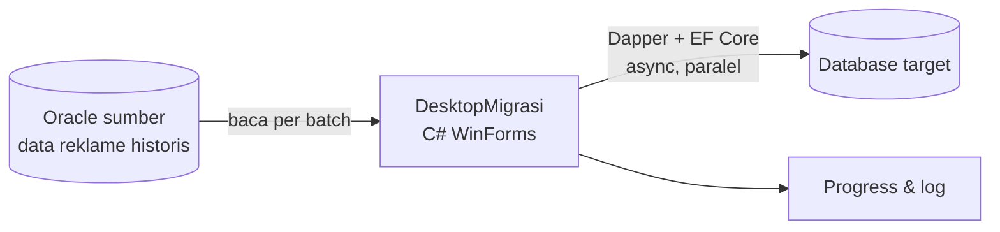

## Latar Belakang / Masalah

Data reklame historis perlu dipindahkan ke database target. Data ini mencakup Permohonan, NOR, NLOR, Survey, Survey Terbatas, SKPD, Realisasi, dan Foto Survey. Volumenya besar, dan sebagian berupa data biner (foto). Karena itu migrasi tidak bisa dikerjakan dengan satu query sederhana.

## Solusi & Arsitektur

- Aplikasi desktop **DesktopMigrasi** dibangun dengan C# WinForms.
- Pembagian akses data:
  - Dapper untuk baca dan tulis massal yang cepat. <!-- TODO: verifikasi pembagian Dapper vs EF Core -->
  - EF Core untuk bagian yang butuh model entitas.
- Teknik pemrosesan: batch processing, async, dan parallel processing.
- Progress monitoring di UI dan logging per tahap, sehingga migrasi bisa dipantau dan ditelusuri jika gagal.
- Fokus terbaru adalah migrasi Foto Survey dari Oracle ke database target.

<!-- TODO: verifikasi diagram — alur disederhanakan dari deskripsi -->

## Tantangan Teknis

- **ORA-01000 (maximum open cursors exceeded):** muncul saat banyak operasi berjalan bersamaan. Penanganannya lewat pengelolaan siklus hidup koneksi dan command. <!-- TODO: verifikasi solusi persisnya -->
- **Timeout** pada query dan transfer data besar.
- **EF change tracking** yang membuat memory membengkak pada batch besar.
- **Penggunaan memory** saat memindahkan data biner foto survey.

## Hasil / Dampak

- Proyek masih berjalan. <!-- TODO: isi hasil setelah migrasi selesai (tanpa angka perkiraan) -->

## Yang Saya Pelajari

- Batas sumber daya Oracle (cursor, koneksi) menjadi nyata saat paralelisme dinaikkan.
- Kapan memakai Dapper dan kapan memakai EF Core untuk beban kerja massal. <!-- TODO: verifikasi -->
- Progress monitoring dan logging adalah syarat migrasi yang bisa dipercaya, bukan fitur tambahan.
