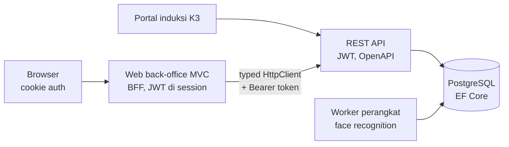

## Latar Belakang / Masalah

Sistem keamanan gerbang mencakup registrasi tamu dan kontraktor, ijin kerja, induksi K3, receptionist, kontak permanen, pelanggaran, dan perangkat face recognition. Sistem ini berjalan di aplikasi web legacy (ASP.NET MVC lama). Aplikasi perlu dimigrasi ke stack modern (.NET 10, PostgreSQL), dengan pemisahan lapisan data, API ber-JWT, dan UI yang konsisten.

## Solusi & Arsitektur

- **Solusi multi-project:** library data (EF Core + Npgsql), REST API (JWT, OpenAPI), web back-office MVC, portal induksi K3, worker service perangkat, dan wrapper SDK perangkat.
- **Web back-office sebagai BFF:** browser memakai cookie auth, sedangkan JWT dari API disimpan di session server dan ditempel oleh handler Bearer token. Cookie tanpa token yang valid dianggap belum login.
- **Lapisan akses API:** typed HttpClient ditambah satu service per resource sebagai satu-satunya tempat yang tahu path endpoint. Controller tipis dan async.
- **Konvensi halaman:** Areas per modul, view-model bersarang (Index/Add/Edit), partial grid yang dimuat ulang lewat AJAX, modal bersama, helper JS bersama, DevExtreme untuk form dan tabel.
- **Keamanan:** record diakses lewat key terenkripsi yang berlaku per hari, anti-forgery token di semua POST AJAX, captcha HMAC sekali pakai, dan konfigurasi rahasia lewat user-secrets/env.
- **Tooling:** generator enum dari API, generator halaman report dari satu spesifikasi, generator controller, dan script recolor tema.

<!-- Diagram disederhanakan dari rekap analisis kode, bukan dari dokumen arsitektur resmi -->

### Modul

- **Master data:** customer, jenis rapat, fasilitas, mesin, lokasi, ruang meeting, departemen, dokumen, safety tool, kerusakan, jabatan, entry location, dan lainnya.
- **Working permit, registrasi, induksi, meeting room:** registrasi tamu/kontraktor dengan approval, ijin kerja, jadwal induksi K3, dan pemesanan ruang meeting.
- **Receptionist & perekaman:** check-in/out tamu, perekaman identitas lewat kamera browser, serta cetak kartu ID.
- **User & API management:** menu, role dengan tree hak akses, workflow approval, user login, serta akun API per web service.
- **Violation, Induction Online, PAN, kartu:** pelanggaran dengan approval berjenjang, kuis dan materi induksi, monitoring kru kapal, dan editor layout kartu ID.
- **Report:** 11 laporan dengan filter, grid, dan export Excel yang digenerate dari satu spesifikasi.

## Tantangan Teknis

- **Token dan sesi kedaluwarsa tidak sinkron:** cookie 3 jam sliding, session 3 jam idle, JWT berlaku sampai tengah malam, dan session in-memory hilang saat restart. Solusinya: validitas token dicek di setiap request, dan respons 401 dari API menghapus token sehingga request berikutnya logout dengan bersih.
- **Error API yang seragam HTTP 200:** API selalu membalas 200 dengan status di envelope. Client memetakan status ke exception spesifik: pesan bisnis ke user, 401 logout, 403 akses ditolak, 429 rate limit, dan error lain ter-log dengan TraceId.
- **Tema DevExtreme dan dark mode template admin:** template menyimpan setting hanya di `sessionStorage` dan me-reload bila atribut `<html>` berubah. Solusinya: mode disimpan ke `localStorage`, `sessionStorage` diisi sebelum skrip layout berjalan, dan tema DevExtreme diganti saat mode berubah.
- **Migrasi bertahap:** banyak halaman legacy di-clone UI-nya dulu dengan data dummy, lalu disambungkan ke API modul per modul tanpa mengubah konvensi halaman.

## Hasil / Dampak

<!-- TODO: verifikasi — isi dengan dampak nyata (jumlah halaman yang dimigrasi, pengguna, atau waktu proses) -->

## Yang Saya Pelajari

<!-- TODO: verifikasi -->
