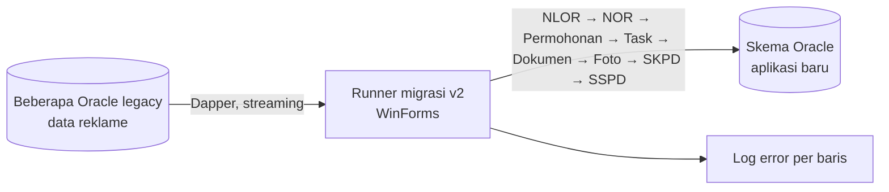

## Latar Belakang / Masalah

Data pajak reklame tersebar di beberapa database Oracle sistem lama: wajib pajak, objek dan lokasi reklame, permohonan izin (insidentil, permanen, terbatas), hasil survey lapangan beserta fotonya, ketetapan (SKPD), dan pembayaran (SSPD). Data ini harus dipindahkan ke skema aplikasi baru yang strukturnya berbeda (kunci komposit, detail per sisi, workflow).

Kualitas data lama juga tidak konsisten: nomor formulir dobel, kolom wajib kosong, dan kode jenis yang berbeda.

## Solusi & Arsitektur

- **Lapisan data bersama:** model EF Core hasil scaffold skema target dan factory koneksi.
- **Pola service migrasi:** tiap jenis data punya satu service dengan DTO sumber. Alurnya: query SQL sumber lewat Dapper, petakan ke entity target (termasuk pemetaan kode jenis reklame lama ke master baru), simpan lewat EF Core, lalu laporkan progress ke UI.
- **Toleransi error:** baris yang gagal dilepas dari change tracker lalu dicatat ke log lewat context terpisah. Kegagalan logging tidak menghentikan migrasi.
- **UI operator:** WinForms dengan progress bar per tahap atau per tahun. Pekerjaan berjalan di background task supaya UI tidak freeze.
- **Tiga generasi tool:** v1 (satu tombol per jenis data), FotoSurvey (khusus foto, per tahun), dan runner v2 (pipeline berurutan, idempoten, dengan retry koneksi).

<!-- Diagram disederhanakan dari rekap analisis kode, bukan dari dokumen arsitektur resmi -->

## Tantangan Teknis

- **Volume data dan BLOB foto:** pembacaan foto dipecah dua tahap (daftar tanpa BLOB, lalu isi per chunk), dan foto yang sudah ada dicek sebelum isinya ditarik. Data sumber lain dibaca streaming lewat data reader.
- **Satu baris rusak menggagalkan satu batch:** batch disimpan dengan satu `SaveChanges`. Bila gagal, change tracker dibersihkan lalu data diulang satu per satu, sehingga hanya baris bermasalah yang masuk log.
- **Kunci komposit yang di-generate aplikasi:** nomor urut pelayanan dihitung per tahun dan bulan, melanjutkan nilai maksimum di tujuan, dan dikembalikan bila batch gagal supaya tidak loncat.
- **Koneksi database putus di tengah migrasi panjang:** kode error Oracle terkait sesi dan jaringan dideteksi, connection pool dibersihkan, lalu tahap diulang (maksimal 5 percobaan, jeda 30 detik). Karena tahap idempoten, pengulangan praktis melanjutkan proses.
- **Data lama tidak konsisten:** kolom wajib divalidasi dan dicatat ke log, formulir dobel dipaksa menjadi satu baris, dan kode jenis lama dipetakan ke master baru.

## Hasil / Dampak

<!-- TODO: verifikasi — isi dengan dampak nyata (mis. jumlah data termigrasi) -->

## Yang Saya Pelajari

- Batas sumber daya Oracle (cursor, koneksi) menjadi nyata saat paralelisme dinaikkan.
- Progress monitoring dan logging adalah syarat migrasi yang bisa dipercaya, bukan fitur tambahan.

<!-- TODO: verifikasi — pelajaran lain dari project ini -->
