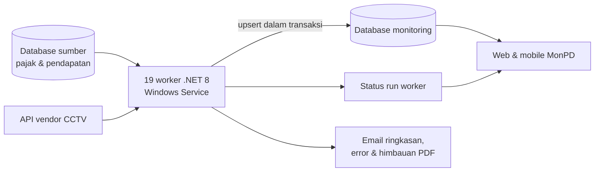

## Latar Belakang / Masalah

Dashboard [MonPD](/projects/monpd) membutuhkan data realisasi dan ketetapan dari semua jenis pajak, data pendapatan, dan data CCTV parkir. Data tersebut tersebar di banyak database dan API vendor yang berbeda. Kalau web mengambil dan mengolah semuanya saat halaman dibuka, halaman menjadi lambat dan membebani database sumber. Karena itu dibutuhkan proses latar belakang yang menyalin dan menyiapkan data secara terjadwal.

## Solusi & Arsitektur

- **Satu worker per domain data:** setiap jenis pajak atau sumber data punya worker .NET 8 sendiri yang berjalan sebagai Windows Service. Kegagalan satu sumber tidak menghentikan sumber lain, dan setiap worker bisa di-deploy dan di-restart terpisah.
- **Library bersama:** worker memakai class library domain dan EF Core yang sama dengan aplikasi web, jadi model data dan aturan bisnis konsisten.
- **Pola sinkronisasi:** ambil data dari sumber per tahun buku, bandingkan dengan data tujuan, lalu insert/update/delete di dalam satu transaksi. Data batal dibersihkan, dan progres serta jumlah perubahan dicatat di log.
- **Monitoring operasional:** setiap worker menulis status run (mulai, selesai, jadwal berikutnya, error) yang dibaca web dan mobile. Email ringkasan harian dan email error dikirim otomatis.
- **CCTV:** worker realtime memproses semua objek parkir secara paralel, memperbarui token API vendor, mencoba ulang request yang gagal dengan jeda bertahap, lalu menyimpan data rekap dan event realtime. Tool desktop (WinForms) dipakai untuk monitoring kamera, sinkronisasi data vendor, dan penarikan history manual.
- **Dokumen otomatis:** worker Himbauan Lapor membuat surat PDF dan mengirimnya lewat email.

<!-- Diagram disederhanakan dari rekap analisis kode, bukan dari dokumen arsitektur resmi -->

### Kelompok worker

- **Sinkronisasi PBJT & pajak daerah:** Hotel, Restoran, Hiburan, Parkir, PPJ, ABT, BPHTB, serta Opsen PKB & BBNKB.
- **Sinkronisasi Reklame:** ketetapan dan realisasi reklame per tahun buku, pembersihan data batal, dan email ringkasan harian.
- **Data pendukung & target:** alat rekam, okupansi, penanggung jawab, realisasi pendapatan, dan target yang diturunkan dari tahunan menjadi bulanan dan harian.
- **CCTV Parkir:** hitungan kendaraan, event, dan gambar dari dua vendor, plus tool desktop pendukung.
- **Notifikasi Himbauan:** surat himbauan PDF untuk objek pajak yang dikirim lewat email.

## Tantangan Teknis

- **Konsistensi data saat sinkronisasi besar:** perubahan per tahun buku dijalankan dalam transaksi dengan rollback, sehingga dashboard tidak pernah membaca data setengah jadi. Jumlah insert/update/delete dicatat di setiap run untuk audit.
- **API vendor CCTV yang tidak selalu stabil:** request diberi retry dengan backoff dan pengecekan pembatalan di setiap percobaan, token diperbarui otomatis, dan objek parkir diproses paralel agar satu objek yang lambat tidak menahan yang lain.
- **Mengetahui kapan worker bermasalah:** status run disimpan terpusat lalu diklasifikasikan (berjalan, macet, gagal, terlambat) di web dan mobile, ditambah email error. Dashboard memakai waktu run terakhir untuk memuat ulang kartu yang datanya berubah.

## Hasil / Dampak

- Menjadi sumber data utama dashboard MonPD yang sudah live untuk Bapenda, UPTB 1–5, dan beberapa OPD Kota Surabaya.
- Data pembayaran semua jenis pajak diperbarui secara terjadwal, sehingga pengguna tidak perlu mengolah data secara manual.

## Yang Saya Pelajari

- **Merancang worker service.** Ini pengalaman baru bagi saya. Worker menyinkronkan data pembayaran semua jenis pajak secara terjadwal agar data di sistem selalu mutakhir dan mendekati real-time. Saya belajar memisahkan proses berat dari aplikasi web dan memantau kesehatan worker (status, run terakhir/berikutnya, error).
