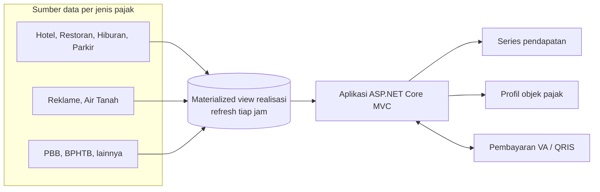

## Latar Belakang / Masalah

Data realisasi pendapatan daerah tersebar di banyak sumber, satu sumber per jenis pajak: hotel, restoran, hiburan, parkir, reklame, air tanah, PBB, BPHTB, dan lainnya. Untuk melihat posisi pendapatan secara utuh, data dari semua sumber itu harus disatukan dan dipetakan ke struktur kode rekening yang sama.
<!-- TODO: verifikasi — apakah sebelumnya rekap dilakukan manual / per sistem? -->

## Solusi & Arsitektur

- **Lapisan data:** materialized view Oracle menggabungkan (`UNION ALL`) realisasi dari berbagai sumber. Setiap baris diberi kode rekening berjenjang (Struktur → Kelompok → Jenis → Obyek → Rincian → Subrincian). View di-refresh otomatis tiap jam.
- **Monitoring khusus:** view terpisah untuk monitoring reklame baru (ketetapan vs pembayaran, survey, bongkar) dan monitoring jambong.
- **Aplikasi:** ASP.NET Core MVC dengan Razor. Dashboard memanggil endpoint lewat jQuery AJAX, dan modal detail/riwayat memakai DevExtreme.
- **Halaman utama:**
  - Series pendapatan daerah sampai grand total, termasuk Pendapatan Transfer, Lain-lain Pendapatan yang Sah, dan Penerimaan Pembiayaan.
  - Profil objek pajak: ringkasan, identitas, riwayat pembayaran, lokasi peta, dan potensi pajak.
- **Pembayaran:** integrasi VA dan QRIS, aksi batal dan lihat SKPD, serta pengecekan status SKPD/SSPD.

<!-- TODO: verifikasi — apakah MonPD Reborn V2 adalah versi pengganti dari MonPD lama? -->

<!-- TODO: verifikasi diagram — alur disederhanakan dari deskripsi, bukan dari dokumen arsitektur resmi -->

## Tantangan Teknis

- Menyatukan banyak sumber data dengan struktur berbeda ke satu skema kode rekening tanpa duplikasi baris.
- Menjaga query view tetap ringan karena di-refresh tiap jam. <!-- TODO: verifikasi -->
- Memperbaiki session, API, dan integrasi backend–frontend pada modul yang sudah berjalan di production.
- Memastikan status SKPD/SSPD dan status pembayaran konsisten dengan sistem pembayaran.

## Hasil / Dampak

- Realisasi 2025–2026 bisa dipantau per kode rekening dari satu tempat.
- Data diperbarui otomatis tiap jam tanpa rekap manual. <!-- TODO: verifikasi -->
- Modul Reklame dan Ops Temuan kini terintegrasi dengan VA/QRIS.

<!-- TODO: tambahkan dampak terukur jika ada data resmi (jangan isi angka perkiraan) -->

## Yang Saya Pelajari

- Merancang materialized view untuk agregasi lintas sumber dan memilih strategi refresh. <!-- TODO: verifikasi -->
- Bekerja hati-hati di production: perubahan kecil pada view bisa berdampak ke banyak dashboard sekaligus.
- Memetakan proses bisnis pendapatan daerah ke struktur kode rekening.
