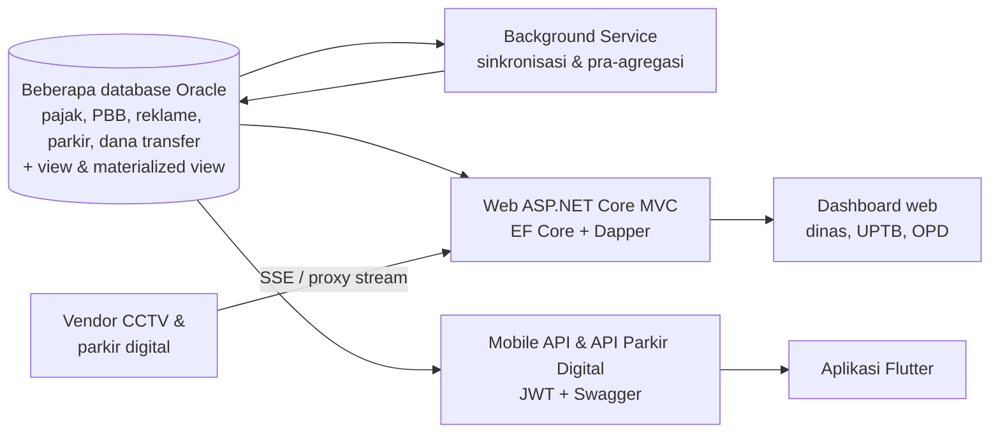

## Latar Belakang / Masalah

Di Badan Pendapatan Daerah (Bapenda) Kota Surabaya, data pendapatan daerah tersebar di beberapa sistem dan database: pajak daerah, PBB, reklame, parkir, dana transfer, dan sistem lama. Pimpinan dan petugas UPTB butuh satu tempat untuk memantau realisasi vs target setiap hari. Mereka juga perlu mengawasi kepatuhan objek pajak (siapa yang belum bayar per masa pajak) dan memantau objek parkir secara langsung lewat CCTV dan transaksi digital.

## Solusi & Arsitektur

- **Aplikasi web ASP.NET Core MVC (.NET 8)** dengan controller tipis. Logika query ada di ViewModel dan domain class di class library bersama, yang juga dipakai project [Background Service MonPD](/projects/monpd-background-service).
- **Lapisan data multi-database:** satu DbContext EF Core (database-first) per sumber data Oracle, plus Dapper untuk query agregasi. Data berat dipra-agregasi oleh Background Service serta view dan materialized view Oracle yang saya buat, lalu web membaca hasilnya. Web menampilkan status tiap worker di halaman Settings dan memakainya untuk refresh otomatis dashboard.
- **Otorisasi:** login berbasis session dengan filter global dan dua audiens login (internal dan petugas non-Bapenda). Data dibatasi per wilayah berdasarkan role di sisi server, dan menu navigasi dibentuk dari data per role.
- **Realtime:** endpoint SSE untuk dashboard parkir digital dan CCTV yang hanya mengirim data saat ada transaksi baru. Stream video vendor CCTV dilewatkan melalui reverse proxy (YARP).
- **Frontend:** Razor + jQuery AJAX, DevExtreme/DataTables untuk grid, ApexCharts/ECharts untuk grafik, Leaflet/Mapbox untuk peta. Skrip bersama menangani lazy-load kartu, skeleton, retry, dan animasi angka.
- **API Parkir Digital:** project Web API terpisah yang menyajikan data akumulasi dan per objek parkir digital, dengan Swagger dan logging Serilog.
- **Mobile API & aplikasi mobile:** endpoint REST terpisah dengan JWT (access + refresh token) dan Swagger UI, dipakai aplikasi mobile Flutter (dibahas di card terpisah).
- **Pengembangan:** hampir seluruh modul saya bangun sendiri; kontributor lain membantu menyelesaikan sebagian modul.
- **Output:** laporan PDF DevExpress, export/import Excel, dan QR code.
- **Hosting:** IIS di Windows Server.

<!-- Diagram disederhanakan dari rekap analisis kode, bukan dari dokumen arsitektur resmi -->

### Modul utama

- **Dashboard & Monitoring Pajak Daerah:** realisasi vs target per jenis pajak (harian, bulanan, per UPTB) dan series multi-tahun.
- **Monitoring Pendapatan Daerah:** realisasi seluruh OPD dengan drill-down PAD, retribusi, dana transfer, serta perbandingan dan perencanaan target.
- **Dana Transfer:** input dana transfer, data akun dan urusan, serta pembukaan tahun buku.
- **Data Objek & Wajib Pajak:** pencarian dan profil objek pajak, ketetapan, kartu data (PDF), dan peta spasial.
- **Pengawasan PBJT:** status sudah/belum bayar per masa pajak untuk restoran, hotel, hiburan, dan lainnya.
- **Pengawasan Parkir & CCTV:** hitungan kendaraan dan live streaming CCTV, dashboard live parkir digital, pengawasan juru parkir, SLA, dan TSPark untuk petugas lapangan.
- **Pengawasan Reklame:** pendataan, survey, input temuan, monitoring izin dan tagihan, serta cetak jambong.
- **Pengawasan PBB:** monitoring SPPT, potensi, profil, dan kategori PBB.
- **Laporan Strategis:** pembayaran dan piutang, alat rekam online, pemeriksaan, serta kalkulator prediksi penerimaan.
- **Monitoring Wilayah & Perizinan:** realisasi per wilayah/UPTB dan monitoring perizinan parkir.
- **Upload Data:** upload target, PAK, piutang, dan kategori pajak dari Excel.
- **Manajemen Pengguna & Settings:** pegawai, user, role, menu per role, dan status worker service.
- **Mobile API:** login JWT dengan refresh token, profil, dashboard, status worker, dan dokumentasi Swagger untuk aplikasi Flutter.
- **API Parkir Digital:** endpoint akumulasi data parkir digital, daftar objek parkir, dan data per objek pajak.

## Tantangan Teknis

- **Dashboard berat dari banyak sumber data:** setiap kartu dimuat terpisah lewat AJAX dengan skeleton dan tombol retry. Query yang tidak saling bergantung dijalankan paralel, query baca berjalan tanpa change tracking, dan agregasi berat diserahkan ke Background Service serta view dan materialized view Oracle. Dashboard mendeteksi kapan worker terakhir berjalan dan hanya memuat ulang kartu yang terkait.
- **Data live parkir/CCTV:** SSE memakai *watermark* waktu transaksi terakhir, sehingga payload lengkap hanya dikirim saat ada data baru. Koneksi dihentikan lewat cancellation token, dan buffering proxy dimatikan. Video vendor diproksikan agar kredensial vendor tidak sampai ke browser.
- **Sesi berakhir di aplikasi yang banyak AJAX:** request AJAX mendapat 401 JSON, bukan redirect, supaya halaman login tidak tersisip ke dalam grid. Handler global di sisi klien menampilkan toast, lalu mengarahkan ke halaman login.
- **Aturan bisnis kepatuhan PBJT:** status bayar per masa pajak memperhitungkan masa aktif objek (tanggal buka/tutup), lapor nihil, dan perbedaan realisasi per tanggal bayar vs per masa pajak.

## Hasil / Dampak

- Versi web sudah live dan dipakai oleh dinas (Bapenda), UPTB 1 hingga 5, serta beberapa OPD lain di Kota Surabaya.
- Realisasi pajak, kepatuhan objek pajak, dan pengawasan parkir/reklame/PBB kini dipantau dari satu platform, bukan dari banyak sistem terpisah.
- Pengguna bisa langsung melihat laporan realisasi dan pengawasan tanpa harus mengolah data secara manual.
- Mobile API sudah tersedia sebagai backend untuk aplikasi mobile Flutter.

## Yang Saya Pelajari

- **Menggabungkan banyak database dalam satu alur data.** Ini pertama kalinya saya menyatukan data dari beberapa database Oracle sekaligus di satu method untuk melengkapi data yang ditampilkan. Saya belajar mengelola beberapa DbContext, mencocokkan data antar sumber, dan menjalankan query paralel supaya halaman tetap cepat.
- **View dan materialized view Oracle.** Bagian terbesar yang saya pelajari justru di sisi database. Saya membuat view dan materialized view Oracle untuk menggabungkan data dari berbagai sumber dan mempra-agregasi data yang dibaca dashboard, sehingga halaman tidak perlu menghitung ulang data besar setiap kali dibuka.
- **Server-Sent Events untuk data live.** Di menu Parkir Digital dan CCTV, saya memakai SSE agar data transaksi dan kendaraan masuk secara real-time tanpa memuat ulang halaman. Saya belajar menjaga koneksi stream tetap stabil, hanya mengirim data saat ada transaksi baru, dan menutup koneksi dengan benar saat pengguna meninggalkan halaman.
