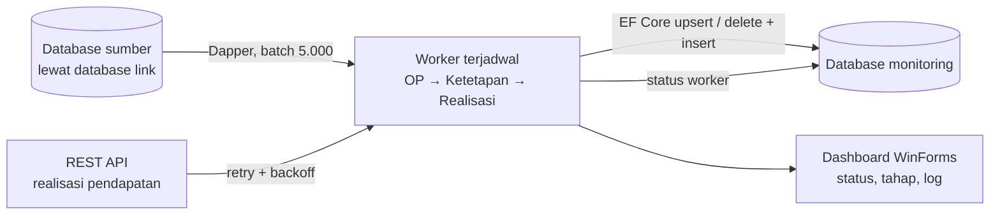

## Latar Belakang / Masalah

Data pajak daerah (objek pajak, ketetapan, dan realisasi pembayaran per jenis pajak, serta realisasi pendapatan daerah) tersebar di beberapa database sumber dan layanan API. Sistem monitoring membutuhkan salinan yang konsisten dan rutin diperbarui di satu database terpusat.

Sebelumnya sinkronisasi ini dijalankan oleh beberapa background service terpisah, sehingga status dan error tiap proses sulit dipantau. MonPDSync dibangun untuk menggantikan service-service tersebut secara bertahap dalam satu aplikasi dengan dashboard status terpusat.

## Solusi & Arsitektur

- **Dua lapisan proyek:** class library data (entity EF Core hasil scaffold database-first, helper koneksi, enum status dan jenis pajak) dan aplikasi WinForms (UI + worker).
- **Base worker abstrak:** setiap worker cukup mendefinisikan tahapan berurutan. Base class menangani timer, lock anti-overlap, cancellation, perhitungan jadwal berikutnya, dan event status, tahap, serta log.
- **Service manager:** registry worker dengan fungsi Start/Stop semua. Worker diaktifkan manual per jenis pajak dari UI.
- **Pola baca-tulis:** sumber dibaca dengan Dapper (SQL mentah, paging `ROWNUM`, deduplikasi `ROW_NUMBER()`, query lintas database link). Target ditulis dengan EF Core per batch memakai context baru dan change tracking manual.
- **Loop rentang tahun:** ketetapan dan realisasi diproses per tahun dari tahun awal di konfigurasi sampai tahun berjalan. Kegagalan satu tahun dicatat, dan tahun berikutnya tetap diproses.
- **Status terpusat:** status tiap worker (berjalan, berhasil, gagal, jadwal berikutnya, pesan error) dicatat ke database agar bisa dipantau sistem lain.

<!-- Diagram disederhanakan dari rekap analisis kode, bukan dari dokumen arsitektur resmi -->

## Tantangan Teknis

- **Volume data besar dan batas Oracle:** data dibaca bertahap per 5.000 baris, pencarian data lama dipecah per 900 kunci, dan insert disimpan per 1.000 baris. Auto-detect-changes EF Core dimatikan dan change tracker dibersihkan setelah tiap simpan agar memori dan waktu tetap terkendali.
- **Penggantian data tanpa kehilangan data:** realisasi diganti per tahun dengan delete + insert dalam satu transaksi. Delete baru dijalankan setelah batch sumber pertama berhasil diambil. Jika sumber kosong atau error, transaksi tidak di-commit dan data lama tetap utuh.
- **Data sumber yang tidak lengkap:** NOP kosong diberi NOP pengganti unik, pembayaran tanpa OP dipetakan ke OP penampung per wilayah, ketetapan yang hilang dibuat dari data realisasi, dan tanggal tutup OP diturunkan dari ketetapan terakhir.
- **Penjadwalan dan concurrency:** timer one-shot dihitung dari jam terjadwal sebelumnya agar tidak jalan dua kali. Lock mencegah run tumpang-tindih, pembatalan selalu diteruskan agar Stop langsung berhenti, dan pemanggilan API diberi retry dengan backoff.

## Hasil / Dampak

- **Konsolidasi service:** background service sinkronisasi yang sebelumnya terpisah mulai digabung ke satu aplikasi. Worker Realisasi Pendapatan (API) dan Restoran sudah live di produksi. Worker Hotel, Hiburan, dan Parkir sudah terimplementasi tetapi belum live, dan jenis pajak lain masih berupa kerangka.
- **Monitoring lebih mudah:** status, tahap aktif, log, error, dan jadwal berikutnya tiap worker terlihat di satu dashboard dan tercatat ke database.

<!-- TODO: verifikasi — angka konkret (jumlah service yang digantikan, volume data, waktu proses) -->

## Yang Saya Pelajari

<!-- TODO: verifikasi -->
