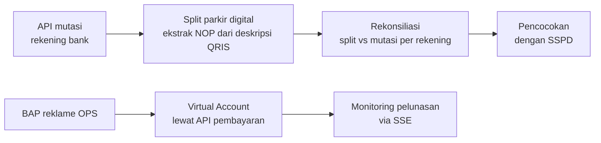

## Latar Belakang / Masalah

Bendahara penerimaan pendapatan daerah perlu memverifikasi permohonan (misalnya pencairan jaminan bongkar reklame), mencocokkan uang masuk di rekening bank dengan dokumen setoran (SSPD), dan memproses penerimaan baru seperti parkir digital berbasis QRIS serta penindakan reklame di lapangan. Proses manual rawan selisih dan lambat ditelusuri. <!-- TODO: verifikasi -->

## Solusi & Arsitektur

- Solusi .NET 8 tiga lapis: web MVC (UI + controller), class library domain dan data bersama, serta Web API kecil (JWT + Swagger) untuk integrasi e-payment.
- Akses data hybrid: EF Core (Oracle) untuk CRUD dan transaksi, Dapper untuk query laporan dan realisasi yang berat. Tiga DbContext untuk tiga database sumber.
- Otorisasi berbasis menu dinamis: tiap role dipetakan ke daftar controller, dan akses di luar hak diblokir di controller dasar.
- Workflow approval generik (master workflow/activity + My Task) dipakai lintas modul permohonan.
- UI DevExtreme (DataGrid/PivotGrid dengan export Excel/PDF) dan DevExpress Reporting untuk dokumen cetak.
- Integrasi HTTP ke API pembayaran (token, VA, callback VA/QRIS), API mutasi bank, dan API ketetapan reklame.

<!-- Diagram disederhanakan dari rekap analisis kode, bukan dari dokumen arsitektur resmi -->

### Modul yang saya kerjakan

- **Permohonan Nota Dinas & Verifikasi Bendahara:** form permohonan berbasis SSPD dengan upload dokumen, verifikasi bendahara penerimaan, tampilan approval My Task, dan monitoring nota dinas dengan cetak SPP/SPTB/SPT.
- **Parkir Digital (QRIS):** Split Parkir Digital, Rekon Parkir Digital, dan Monitoring Split (master-detail). Saya juga mengerjakan versi awal Menunggu Transfer (split mutasi debit) sebelum modul itu dipindah ke project lain.
- **Operasi Reklame (OPS) & Stiker:** BAP Reklame OPS dengan Virtual Account (dirancang dari awal), Stiker Insidentil dan Temuan, OPS Batal, dan Monitoring OPS Reklame.

## Tantangan Teknis

- **Parsing dan split mutasi QRIS:** NOP diekstrak dari teks deskripsi transaksi (bersihkan prefix, validasi panjang), lalu data rekening di-resolve sekaligus dalam satu query batch, bukan per baris. Hasil split dipakai ulang bila mutasi sudah pernah diproses.
- **Rekonsiliasi split vs mutasi:** pencocokan per rekening dengan pola full outer join di memori untuk menampilkan selisih di kedua sisi.
- **Konsistensi data stiker dan BAP:** proses ambil, pakai, dan batal stiker serta simpan BAP dibungkus transaksi database agar header-detail tidak tersimpan setengah.
- **Status pembayaran real-time:** stream SSE mengecek callback pembayaran tiap BAP secara berjeda. Error di satu item tidak memutus stream, dan stream berhenti lewat cancellation token saat klien putus.

## Hasil / Dampak

- Rekonsiliasi transaksi parkir QRIS dengan mutasi bank tidak lagi dikerjakan manual, sehingga lebih cepat. <!-- TODO: verifikasi angka waktu sebelum/sesudah -->
- Memproses transaksi lebih dari 30 wajib pajak per hari.
- BAP reklame hasil operasi lapangan bisa langsung dibayar lewat Virtual Account, dan status lunasnya terpantau dari monitoring.

## Yang Saya Pelajari

<!-- TODO: verifikasi -->
