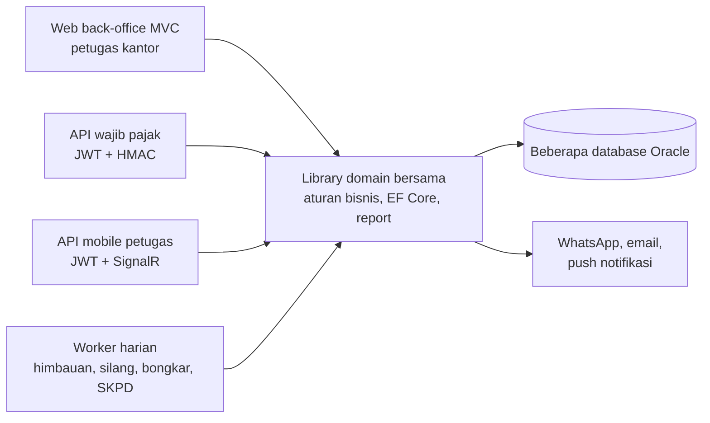

## Latar Belakang / Masalah

Administrasi pajak daerah di Bapenda Kota Surabaya (reklame, PBJT, pendaftaran wajib pajak) membutuhkan banyak tahapan: pengajuan, penelitian berkas, survey lapangan, penilaian, approval berjenjang, penerbitan ketetapan, sampai pengawasan reklame yang kedaluwarsa atau belum dibayar.

Petugas lapangan, petugas kantor, dan wajib pajak membutuhkan kanal yang berbeda. Banyak langkah berbasis tanggal juga harus berjalan otomatis tanpa intervensi manual.

<!-- TODO: verifikasi — tambahkan konteks bisnis (sistem lama yang digantikan, skala pengguna) -->

## Solusi & Arsitektur

- **Library domain bersama** berisi seluruh aturan bisnis, query, konteks EF Core, report DevExpress, dan template email/WhatsApp. Semua host memanggil library ini, sehingga aturan bisnis hanya ada di satu tempat.
- **Host tipis:**
  - Web MVC back-office (Razor + DevExtreme) untuk petugas kantor, dengan login session dan kontrol akses menu per role.
  - API wajib pajak (JWT + HMAC app-key) untuk aplikasi publik: reklame, Air Tanah, dan pembayaran QRIS/VA dengan status realtime lewat SignalR.
  - API mobile petugas (JWT, rate limiting) untuk survey, absensi, laporan harian, dan my task, plus hub SignalR dan hosted service untuk push realtime.
  - Worker service per tahap proses (himbauan, teguran, silang, unsilang, bongkar, SKPD otomatis, notifikasi, pengiriman surat). Setiap worker punya mode simulasi (dry run).
- **Data:** EF Core database-first ke beberapa database Oracle. Aturan bisnis (batas hari, radius survey, mode auto SK) dibaca dari setting di database.
- **Konvensi lintas proyek:** waktu bisnis selalu diambil dari jam server database (bukan jam mesin), ID yang dikirim ke klien dienkripsi, dan response API memakai envelope standar.
- **CI/CD:** GitLab CI membangun semua branch; web di-deploy ke IIS, API ke Linux (systemd + nginx).

<!-- Diagram disederhanakan dari rekap analisis kode, bukan dari dokumen arsitektur resmi -->

### Modul yang saya kerjakan

- **Sendiri:** API mobile petugas (sisi API; aplikasi mobile dibuat tim lain), auto-assign dan Monitoring Assign Task, API Air Tanah, serta master data dan URM.
- **Porsi dominan:** workflow MyTask (approval dan SK) dan penerbitan NPWPD otomatis.
- **Bersama tim:** permohonan dan penilaian reklame, pengawasan temuan, dan master reklame.

## Tantangan Teknis

- **Pembagian tugas lapangan yang adil:** task survey, silang, dan bongkar harus otomatis jatuh ke petugas yang tepat. Kandidat diambil dari tugas fungsi dan wilayah (kelurahan, lalu kecamatan, UPTB, sampai petugas umum), lalu dipilih berdasarkan jatah bulanan, beban total, beban di wilayah, dan NIP sebagai tie-breaker. Task yang baru di-assign dalam transaksi yang sama ikut dihitung, dan setiap kegagalan dicatat dengan alasan yang terbaca di Monitoring Assign Task.
- **Penerbitan NPWPD multi-kanal yang andal:** satu approval menghasilkan SK, surat pengukuhan PDF ber-QR, kode aktivasi lewat WhatsApp dan email, serta notifikasi aplikasi. Proses SK disimpan dalam satu transaksi, sedangkan pengiriman tidak melempar error. Kegagalan per kanal dicatat sebagai hasil kirim, dan email tetap terkirim walau PDF gagal dibuat.
- **Pengaturan realtime ke aplikasi mobile:** radius check-in survey bisa diubah langsung di database. Hosted service membaca ulang nilainya secara berkala dan mem-broadcast event SignalR hanya saat nilainya berubah. Klien yang baru tersambung langsung menerima nilai terkini.
- **Keamanan API mobile:** endpoint absensi dibatasi rate limiter fixed window per user (fallback ke IP), jalur publik diatur di middleware, dan verifikasi kontak memakai OTP.

## Hasil / Dampak

<!-- TODO: verifikasi — belum ada angka; isi dampak nyata setelah ada data (jumlah petugas, permohonan/bulan, waktu proses) -->

## Yang Saya Pelajari

- **Arsitektur multi-host:** semua aturan bisnis ditaruh di satu library domain yang dipakai bersama oleh web back-office, dua Web API, dan belasan worker. Host tetap tipis, dan satu perubahan aturan berlaku di semua kanal.
- **Realtime dan notifikasi:** SignalR + hosted service untuk mendorong perubahan pengaturan ke aplikasi mobile, serta pengiriman multi-kanal (WhatsApp, email, notifikasi aplikasi) yang tidak menggagalkan proses utama saat satu kanal gagal.
- **Algoritma penugasan:** auto-assign task lapangan yang seimbang berdasarkan wilayah, jatah bulanan, dan beban kerja, lengkap dengan log alasan gagal supaya koordinator bisa menindaklanjuti.

<!-- TODO: verifikasi — sesuaikan dengan pengalaman pribadi -->
