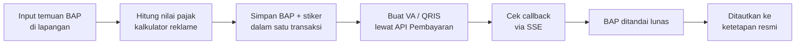

## Latar Belakang / Masalah

Penertiban reklame dan hiburan insidentil di lapangan butuh jembatan antara temuan petugas, penetapan pajak, dan pembayaran. Petugas perlu alat untuk mencatat temuan, menghitung pajak, membuat tagihan, dan memastikan pelunasan tanpa proses manual berlapis. Di sisi wajib pajak (WP), pemilik objek parkir digital perlu memantau transaksi dan mengelola perangkat petugasnya. <!-- TODO: verifikasi konteks bisnis -->

## Solusi & Arsitektur

- Satu aplikasi ASP.NET Core MVC dengan dua "shell": portal WP dan portal Supervisor untuk petugas operasi lapangan (OPS). Masing-masing punya layout, navbar, dan login sendiri (login pegawai berbasis session).
- Controller tipis, lalu view-model, lalu class domain di library bersama, lalu Oracle. EF Core dipakai untuk CRUD, Dapper untuk query lintas sumber data.
- Grid DevExtreme dengan paging dan filter server-side, partial view untuk modal pembayaran dan cetak, serta laporan DevExpress untuk dokumen pajak (SKPD, SSPD, SPTPD, stiker).
- Kontribusi kecil di layanan Pembayaran (ASP.NET Core Web API): endpoint cek VA/QRIS aktif per ketetapan dan cek pembayaran per kode VA/QRIS.

<!-- Diagram disederhanakan dari rekap analisis kode, bukan dari dokumen arsitektur resmi -->

### Modul yang saya kerjakan

- **Portal Supervisor / OPS:** login pegawai, BAP Insidentil Reklame dan Hiburan, verifikasi NIK dan pembuatan NPWPD, pembayaran dan pembatalan BAP, cetak stiker reklame.
- **Penagihan & tunggakan:** Monitoring Objek Pajak, Penagihan Reklame dengan VA/QRIS gabungan, Tunggakan multi-masa (QRIS dibatasi nominal maksimum). Sebagian modul ini dikerjakan bersama rekan.
- **Monitoring OPS Reklame:** daftar BAP aktif dan batal, cetak dokumen, dan cek pelunasan massal lewat SSE (bagian saya: SSE, pembatalan, pembayaran).
- **Parkir Digital (sisi WP):** Monitoring Parkir, Manajemen User Device, Manajemen Parkir Gate, dan halaman publik Cek Data Parkir dari QR terenkripsi.
- **Pajak Air Tanah:** rekap ketetapan ABT per tahun dengan cetak SKPD dan SSPD.

## Tantangan Teknis

- **Konsistensi data multi-tabel:** simpan BAP, stiker, dan pembatalan berjalan dalam transaksi database eksplisit dengan rollback. Penautan BAP ke ketetapan reklame memakai transaksi di dua koneksi (Dapper dan EF Core).
- **Status pembayaran real-time tanpa polling dari banyak tab:** endpoint SSE memeriksa BAP yang belum lunas satu per satu dengan jeda, mengirim event per ID yang terbayar, tetap jalan walau satu ID gagal, dan berhenti rapi saat klien putus lewat cancellation token.
- **Pembayaran gabungan:** satu VA/QRIS untuk banyak ketetapan atau masa sekaligus, dengan validasi item bermasalah dan batas nominal QRIS.
- **Penomoran BAP:** ID dibentuk dari prefix tahun-bulan ditambah urutan empat digit. <!-- TODO: verifikasi apakah perlu penguncian untuk concurrency -->

## Hasil / Dampak

- Aplikasi sudah live dan dipakai wajib pajak serta petugas lapangan.

<!-- TODO: verifikasi — tambahkan dampak terukur (jumlah BAP, petugas pengguna, nilai tagihan) -->

## Yang Saya Pelajari

<!-- TODO: verifikasi -->
